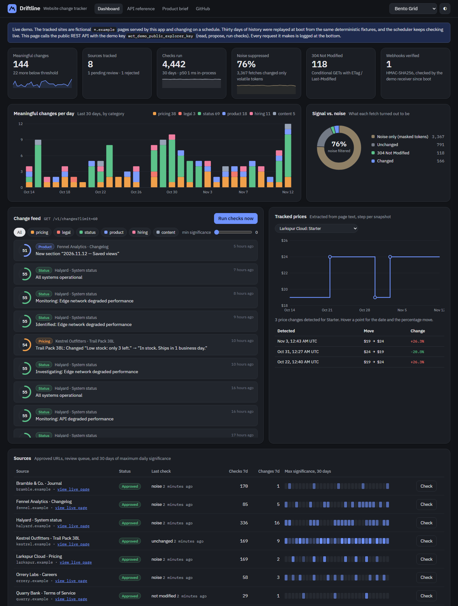
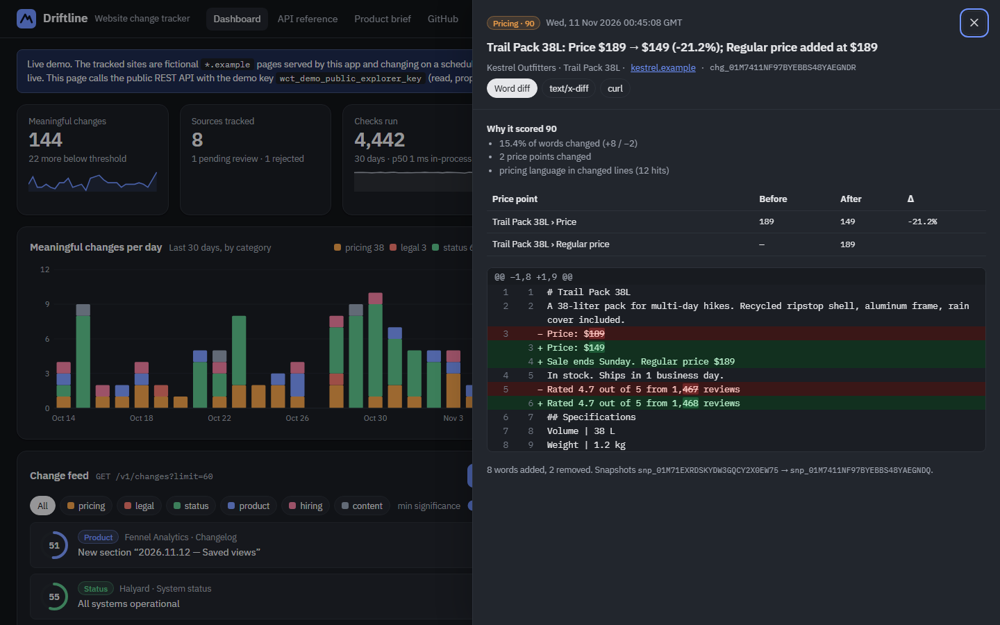
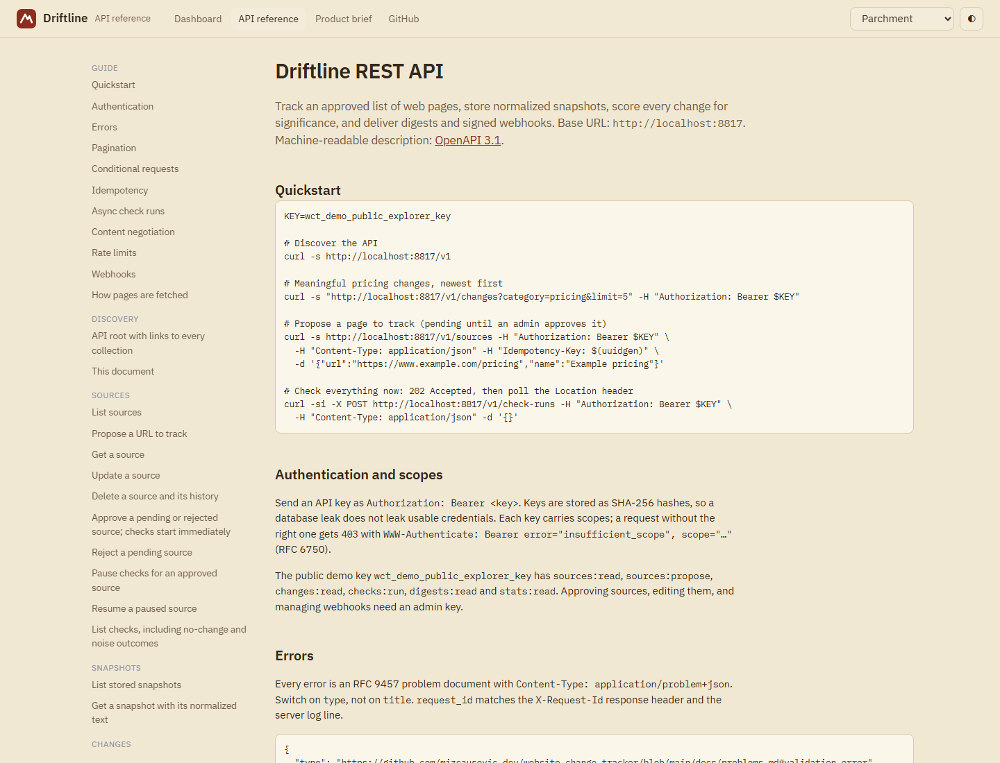
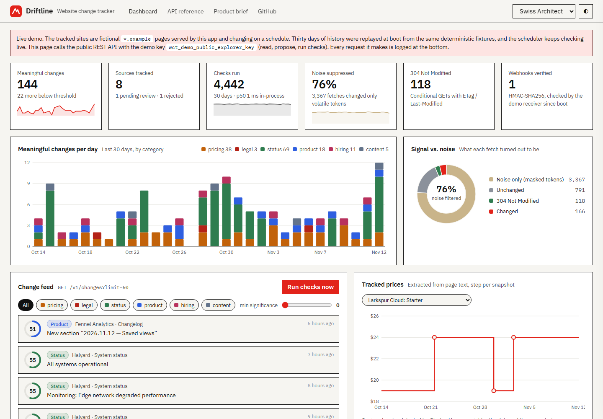
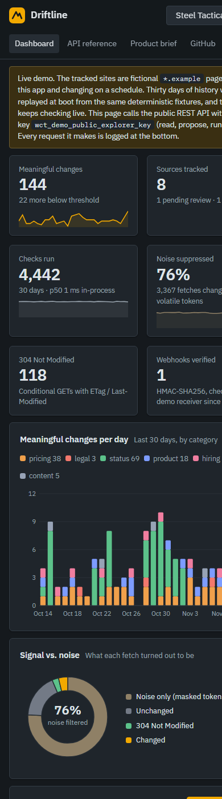
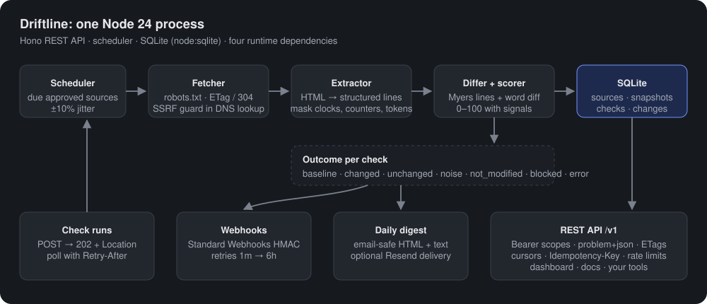
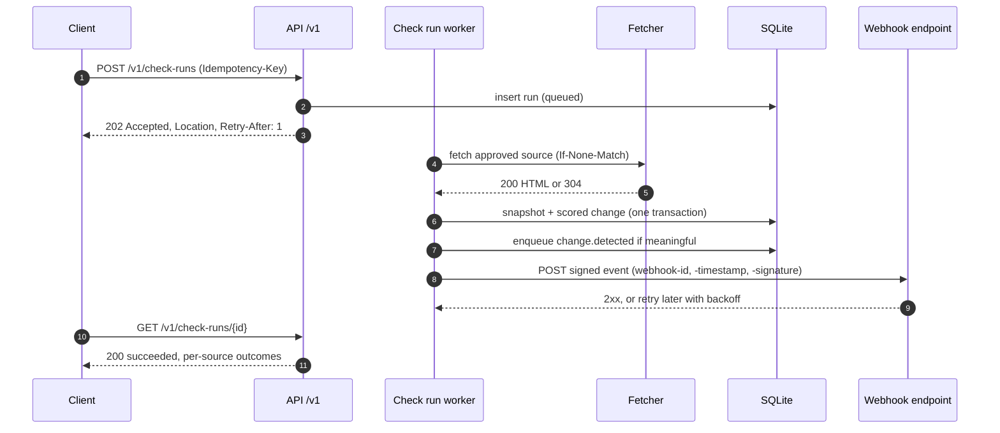

# Driftline: website change tracker

Driftline watches an approved list of web pages and reports the changes that matter. Each check fetches a page politely, reduces it to readable text, masks volatile tokens such as clocks and session IDs, diffs it against the last snapshot, and scores the change from 0 to 100 with the reasons behind the score. Meaningful changes go out as signed webhooks and a daily digest, and everything is available through a versioned REST API.

**Live demo:** https://website-change-tracker-560544171727.us-east1.run.app · **API reference:** https://website-change-tracker-560544171727.us-east1.run.app/docs · **OpenAPI 3.1:** https://website-change-tracker-560544171727.us-east1.run.app/v1/openapi.json · **Product brief:** https://website-change-tracker-560544171727.us-east1.run.app/brief

The demo tracks fictional sites on the reserved `.example` domain, served by the app itself and changing on a schedule. Thirty days of history are replayed at boot from the same deterministic fixtures, then the scheduler keeps checking live. No third-party website is fetched.



| Word-level diff with the scoring signals | API reference rendered from the live OpenAPI document |
|---|---|
|  |  |
| **Swiss Architect theme, light** (7 themes × light/dark) | **390 px phone layout** |
|  |  |

## Try the API

The demo key is public on purpose. It can read everything, propose sources, and start check runs; it cannot approve, edit, or manage webhooks.

```bash
export KEY=wct_demo_public_explorer_key
export API=https://website-change-tracker-560544171727.us-east1.run.app

# Discover
curl -s $API/v1

# Meaningful pricing changes, newest first, with an RFC 8288 Link header for the next page
curl -si "$API/v1/changes?category=pricing&limit=3" -H "Authorization: Bearer $KEY"

# The same change as a unified diff (content negotiation)
curl -s $API/v1/changes/<id> -H "Authorization: Bearer $KEY" -H "Accept: text/x-diff"

# Revalidate with the ETag you got: 304 and an empty body when nothing changed
curl -si $API/v1/stats/overview -H "Authorization: Bearer $KEY" -H 'If-None-Match: "<etag>"'

# Propose a page. Retrying with the same Idempotency-Key replays the first response.
curl -si $API/v1/sources -H "Authorization: Bearer $KEY" -H "Content-Type: application/json" \
  -H "Idempotency-Key: 9b1d7c2e" -d '{"url":"https://www.example.com/pricing","name":"Example pricing"}'

# Check everything now: 202 Accepted with Location and Retry-After, then poll
curl -si -X POST $API/v1/check-runs -H "Authorization: Bearer $KEY" -H "Content-Type: application/json" -d '{}'
```

## What the API demonstrates

| Concern | Implementation | Proven by |
|---|---|---|
| Resource design | `/v1` collections for sources, snapshots, changes, check runs, digests, webhooks; prefixed time-ordered IDs (`src_`, `chg_`…); `links` on every resource | `test/contract.test.ts` |
| Errors | RFC 9457 problem details everywhere, stable `type` URIs documented in [docs/problems.md](docs/problems.md), `request_id` tied to logs | `test/api.test.ts` |
| Validation | Strict bodies: unknown fields are 422, not silently ignored; 400 / 413 / 415 / 422 distinguished | `test/api.test.ts` |
| Pagination | Opaque cursors over ULIDs (`WHERE id < ?`), stable under inserts; `Link: rel="next"` | `walks every page…` test |
| Caching | Strong ETags on every GET, `If-None-Match` → 304 | dashboard traffic log, tests |
| Concurrency | `PATCH` with JSON Merge Patch requires `If-Match`: 428 when missing, 412 when stale | tests |
| Idempotency | `Idempotency-Key` on every POST: replay with `Idempotent-Replayed: true`, 422 on reuse with a different body, scoped per API key | tests |
| Async work | `POST /v1/check-runs` → `202 Accepted`, `Location`, `Retry-After`; poll to `succeeded` | tests, dashboard "Run checks now" |
| Content negotiation | Changes as JSON or `text/x-diff`; digests as JSON, email HTML or text; 406 otherwise; `Vary: Accept` | tests |
| State machine | Source review lifecycle as action sub-resources (`approve`, `reject`, `pause`, `resume`); invalid transitions are 409 with the allowed actions | tests |
| Auth | Bearer API keys hashed at rest, per-scope authorization, RFC 6750 `WWW-Authenticate` challenges | tests |
| Rate limiting | Token bucket per key and client, `RateLimit-*` headers, `Retry-After` on 429, separate bucket for failed auth | tests |
| Webhooks | Standard Webhooks HMAC-SHA256 signatures with timestamps, retries at 1m / 5m / 30m / 2h / 6h, secret shown once; an in-process receiver verifies every delivery in the demo | tests |
| Contract | Hand-written OpenAPI 3.1; tests fail if a route is served but undocumented (or the reverse), and validate real responses with Ajv | `test/contract.test.ts` |

## Architecture





**How "meaningful" is decided.** Raw HTML changes on nearly every request, so diffing markup is useless. The extractor keeps headings, list items and table rows as lines, drops scripts, hidden elements and caller-chosen selectors (ads, carousels), then masks volatile tokens. Each check lands in one bucket:

- **noise**: only masked tokens moved. No snapshot, no alert. In the demo this is about three quarters of all fetches.
- **minor**: real text changed but scored below the source's `min_significance`. Stored and searchable, never pushed.
- **meaningful**: at or above the threshold. Scored from the share of words changed, extracted price moves, category language (legal, pricing, status, product, hiring), section headings, and changed numbers. Tiny edits are halved unless money, a percentage or legal text moved. Every change lists its `signals`.

**Design trade-offs.**

- *SQLite in one process.* It keeps the demo to one container and lets the scheduler, rate limiter and idempotency store share memory. Scaling out moves state to Postgres, checks to a queue, and limits to Redis; the transport, extractor, scorer and store are separate modules so each swap is local.
- *Hand-written OpenAPI.* Generating it from validators would add a schema library. Instead the contract tests hold the document and the router to each other in both directions.
- *No regex from callers.* `ignore_patterns` are literal text with `*` wildcards, matched by a plain scanner with a hard per-page work budget. Version 1.0.1 and earlier compiled wildcards to a backtracking regex, which stacked wildcards could stall for seconds; see the changelog for 1.0.2. Built-in noise filters run on page text the tracked site controls, so they are kept linear too.
- *TypeScript without a build.* Node 24 strips types at load time, so the container runs `src/server.ts` directly. `tsc --noEmit` still type-checks in CI.

## Security

The fetcher is the dangerous part of any change tracker: it requests URLs that callers supply. Only approved sources are fetched; DNS answers are checked inside the socket lookup so a name cannot re-resolve to an internal address between validation and connection; IP-literal hosts are checked separately because Node skips the lookup hook for them (a negative test caught exactly that gap during development); redirects stay on the same site; responses are capped at 2 MB after decompression. Details and the full control table: [SECURITY.md](SECURITY.md).

## Run it locally

Requires Node 24.11 or newer (the container uses 24.22.3).

```bash
npm ci
npm start            # http://localhost:8080, demo data seeded at boot
npm run check        # tsc --noEmit + the test suite
```

Configuration (environment variables):

| Variable | Default | Purpose |
|---|---|---|
| `PORT` | `8080` | Listen port |
| `PUBLIC_BASE_URL` | `http://localhost:$PORT` | Base for `links` and `Location` headers |
| `ADMIN_API_KEY` | unset | Key with every scope; at least 32 characters or it is ignored |
| `DEMO_MODE` | `true` | Seed the fictional sites and 30 days of history |
| `ALLOW_EXTERNAL_FETCH` | `false` | Fetch real hosts. Off: non-`.example` sources record `blocked` |
| `TRUST_PROXY` | `false` (`true` in the image) | Read the client IP from the last `X-Forwarded-For` entry |
| `DATABASE_PATH` | `:memory:` | SQLite file path for persistence |
| `RESEND_API_KEY`, `DIGEST_FROM`, `DIGEST_TO` | unset | Email the daily digest through Resend |
| `SCHEDULER` | on | `off` disables background checks |

## Deploy

The live demo runs on Google Cloud Run from the Dockerfile in this repository (base image pinned by digest, non-root user, no package managers at runtime, no build step). `.gcloudignore` is an allowlist, so only the Dockerfile, lockfile, `src/` and `public/` are uploaded.

```bash
gcloud run deploy website-change-tracker --source . --region us-east1 \
  --allow-unauthenticated --max-instances 1 --min-instances 0 --cpu-boost \
  --concurrency 80 --timeout 60 \
  --service-account <runtime service account with no project roles> \
  --set-env-vars PUBLIC_BASE_URL=<service url>,TRUST_PROXY=true
```

- `--max-instances 1` matters: the rate limiter, idempotency store and scheduler are in-process. With `--min-instances 0` the service scales to zero when idle and reseeds the same deterministic history on the next cold start. On Cloud Run that replay takes about 6 to 7 seconds (measured from the boot log), so the first request after an idle period is slow; `--min-instances 1` removes the wait at the cost of an always-on instance. The scheduler only runs while the instance is serving.
- The public demo runs **without** an admin key, so approving, editing and webhook management are unreachable there. To enable them, store a key in Secret Manager, grant the runtime service account `roles/secretmanager.secretAccessor` on that one secret (not the project), and add `--set-secrets ADMIN_API_KEY=<secret>:<version>`.
- `TRUST_PROXY=true` belongs in the service config, not the image: it is only correct behind a proxy that appends the client address to `X-Forwarded-For`.

## Project layout

```
src/
  app.ts                 Hono app: middleware order, error handler, routes, static pages
  server.ts              boot: config, seed, scheduler, graceful shutdown
  core/                  fetcher, ssrf, robots, extract, diff, significance, pipeline, digest, webhooks, scheduler, stats
  http/                  auth, rate limit, problem details, pagination, validation, representations, middleware
  routes/                sources.ts (lifecycle), activity.ts (changes, runs, digests, webhooks, stats)
  fixtures/              fictional .example sites (pure functions of time) and the history seeder
  openapi.ts             OpenAPI 3.1 document
public/                  dashboard, API reference, product brief (vanilla JS, self-hosted fonts, strict CSP)
test/                    unit, API, contract and network-guard tests (node:test)
```

## License

MIT for the code. IBM Plex fonts are under the SIL Open Font License 1.1.
